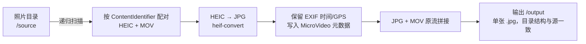

# live2motion

把苹果 **Live Photo** 转换成一张 **Motion Photo**。

Live Photo 在磁盘上是两个文件（一张 `.HEIC` + 一段 `.MOV`），Motion Photo 是**一个** `.jpg`：
前半是 JPG 图像，尾部直接拼接原始视频，再在 XMP 里写明视频的起始偏移。支持这个格式的相册
会把它显示成一张「按住会动」的动态照片，而不是「照片 + 视频」两份。

本项目只做这一件事：给它一个装满照片的目录，它递归扫描、按 UUID 配对、转码、写出成品。
不读取任何相册软件的数据库，也不关心产物之后被同步、备份到哪里——那是你自己的事。




---

## 核心特性

| 能力 | 说明 |
| --- | --- |
| **UUID 配对** | 只认 `ContentIdentifier`，文件名、目录名、修改时间都不参与配对——改名不会拆散一对实况 |
| **增量扫描** | mtime 未变的文件不重复解析元数据、不重复算 MD5；已成功的任务不重复转换 |
| **MD5 完整性校验** | 源文件与产物都记 MD5；支持周期性「深度校验」，发现 `mtime 未变但内容变了` 的静默损坏（bit rot） |
| **并发控制** | 可配置并发数（默认 2），改完**立即生效**无需重启 |
| **容错** | 失败指数退避重试（默认 3 次），容器重启后未完成的任务自动回到队列继续 |
| **源目录只读** | 只以只读方式打开源文件，绝不往源目录写入 |
| **完整图库模式** | 可选：输出目录 = 转换产物 + 已定型文件的原样副本，目录结构与源目录一致。转换成功的双文件只出 JPG；新到/刚失败的源文件先过观察期才写，避免同一张实况以多种形态流出去 |
| **Web 面板** | 仪表盘 / 任务列表 / 实时日志 / 设置，构建期打进二进制，不依赖任何外部服务 |
| **界面** | 玻璃拟态 + 极光背景，按浏览器本地时间（06:00–18:00）自动切换日夜配色 |
| **通知** | 以「一轮扫描 → 处理结束」为单位推送汇总，不逐张刷屏；自动适配钉钉/飞书/企微/Slack/Discord/ntfy/Bark |

---

## 快速开始

### 1. docker compose（推荐）

```bash
docker pull andreasgyh/live2motion:latest
```

新建 `docker-compose.yml`，把两条路径改成你自己的：

```yaml
services:
  live2motion:
    image: andreasgyh/live2motion:latest
    container_name: live2motion
    restart: unless-stopped
    ports:
      - "8080:8080"
    environment:
      - TZ=Asia/Shanghai
    volumes:
      - /volume1/photo:/source:ro            # 照片目录，必须 :ro
      - /volume1/photo-motion:/output        # 转换产物
      - live2motion_data:/data               # 程序数据（具名卷）

volumes:
  live2motion_data:
```

```bash
docker compose up -d
docker compose logs -f
```

打开 `http://<NAS-IP>:8080`。

> **关于 `/data`**
>
> 用默认的具名卷最省事。Linux/NAS 上换成 `./data:/data` 也没问题；
> Windows/macOS 的 Docker Desktop 请保持具名卷，绑定宿主机目录在部分文件系统上会不稳定。

### 2. docker run

```bash
docker run -d --name live2motion \
  --restart unless-stopped \
  -p 8080:8080 \
  -v /volume1/photo:/source:ro \
  -v /volume1/photo-motion:/output \
  -v live2motion_data:/data \
  -e TZ=Asia/Shanghai \
  andreasgyh/live2motion:latest
```

### 3. 第一次使用建议

1. 打开 **仪表盘 → Dry-Run**，只做扫描与配对，确认「配对组数」符合预期；
2. 打开 **任务列表**，检查 UUID、HEIC 路径、视频路径是否成对；
3. 确认无误后关闭 Dry-Run，任务立即开始转换；
4. 定期看 **日志** 页的 `warn` / `error`。

---

## 配置

优先级：**Web 设置页 > 环境变量 > 内置默认值**。
环境变量只在首次建库时作为初始值写入，之后以 Web 设置为准。

| 环境变量 | 默认值 | 说明 |
| --- | --- | --- |
| `L2M_SOURCE_DIR` | `/source` | 源目录（只读挂载） |
| `L2M_OUTPUT_DIR` | `/output` | 输出目录 |
| `L2M_DATA_DIR` | `/data` | 数据目录 |
| `L2M_WEB_ADDR` | `:8080` | Web 监听地址 |
| `L2M_LOG_LEVEL` | `info` | `info` / `warn` / `error` |
| `L2M_WORKERS` | `2` | 并发转换数（1-16） |
| `L2M_JPG_QUALITY` | `100` | 输出 JPG 质量 |
| `L2M_ENABLE_MD5` | `true` | MD5 完整性校验总开关 |
| `L2M_AUTO_SCAN` | `true` | 是否后台持续扫描 |
| `L2M_SCAN_INTERVAL_SEC` | `300` | 扫描间隔（秒，最小 10） |
| `L2M_MAX_RETRIES` | `3` | 失败重试次数 |
| `L2M_OUTPUT_SUFFIX` | `-motion` | 输出文件名后缀 |
| `L2M_INCLUDE_UNCONVERTED` | `false` | 完整图库模式：把未参与转换的源文件原样复制到输出目录（见下文） |
| `L2M_MIRROR_SETTLE_MIN` | `30` | 镜像观察期（分钟）：新到/刚失败的源文件先不写进输出目录，等定型；`0` = 立即写 |
| `L2M_AUTO_THEME` | `true` | 面板是否按本地时间自动切换日间/夜间配色 |

Web 设置页还可以改：输出文件名后缀、HEIC/视频扩展名、深度校验周期、日志保留条数、是否转换前校验源 MD5、是否保留原始 Orientation、是否开启完整图库模式、镜像观察期、通知。

---

## 目录行为与环境自检

三个挂载路径的处理策略不同，这是刻意的：

| 路径 | 不存在时 | 原因 |
| --- | --- | --- |
| `/source` 源目录 | **不创建，直接报错** | 自动建个空目录只会把「挂载漏了」表现成「扫描成功但 0 个文件」，比报错难排查得多 |
| `/output` 输出目录 | **自动创建** | 程序自己的产出位置，建目录是合理默认行为 |
| `/data` 数据目录 | **自动创建** | 程序状态必须能落盘 |

启动时会自动执行一次环境自检，结果直接显示在仪表盘顶部：

- **阻断项** —— `exiftool`、`heif-convert`、输出目录可写、数据目录可写。
  任一项不通过 → 横幅显示 **「转换已暂停」**，队列原样保留，不会把任务逐条重试成失败。
- **非阻断项** —— 源目录是否存在 / 可读。
  只有这一项失败时横幅显示 **「仅影响扫描」**，转换能力不受影响。

修好挂载后，点横幅右上角的 **「重新检测」** 即可恢复，**不需要手工重跑失败任务**。

保存设置时的校验：

- 源目录**发生变化**时才强制要求它已存在（只改并发数、质量不会被路径问题卡住）；
- 输出目录自动创建；
- 输出目录落在源目录内部、或二者互相包含，会被拒绝并提示。

---

## 输出格式

输出是一个**单文件**：

```
[ JPG 数据 ][ MOV 数据 ]
|<-- N 字节 -->|
```

- 视频**原样拼接，不转码**，字节数与源文件完全一致；
- 写入 `MicroVideo` / `MicroVideoVersion` / `MicroVideoOffset` 三项元数据，`MicroVideoOffset` 精确等于 JPG 部分的字节长度；
- 源文件的拍摄时间、GPS 等 EXIF 信息会带到新 JPG 上；
- 落盘前会回读校验元数据，不通过直接判失败，绝不产出坏图；
- 临时文件与成品同目录，写完才原子重命名，监听输出目录的工具不会看到半成品。

---

## 输出内容：两种模式

`/output` 里到底放什么，由 **完整图库模式**（设置页「输出内容」）决定。

| | 关闭（默认） | 开启 |
| --- | --- | --- |
| 转换成功的 Live Photo | `IMG_0001-motion.jpg` | `IMG_0001-motion.jpg`，原始 HEIC/MOV **不**复制 |
| 普通照片 / 未配对视频 / 其它文件 | 不输出 | 原样复制，相对路径与源目录一致 |
| 适用场景 | 只想补出动态照片 | 想让 `/output` 成为一份完整、可直接拿去用的照片库 |

### 为什么需要这个开关

Live Photo 在磁盘上是两个文件（HEIC + MOV），转换后是一个 JPG。如果源目录和输出目录
被同一套流程对外提供，同一张实况就会以「静态照片 + 视频 + 动态照片」几种形态重复出现。

开启后输出目录的形态是：

```
/output/2024/05/IMG_0001-motion.jpg   ← 由 IMG_0001.HEIC + IMG_0001.MOV 合成，原件留在 /source
/output/2024/05/IMG_0002.HEIC         ← 普通照片（没有 ContentIdentifier），原样复制
/output/2024/06/VID_0001.MOV          ← 找不到 HEIC 的孤儿视频，原样复制
/output/2024/06/IMG_0003.HEIC         ← 转换失败的实况原图，原样复制（至少不丢照片）
```

路径结构与源目录**完全一致**（同样是 `年/月/文件名`），不会全部混在输出根目录里。

### 哪些文件会被复制

输出目录只写「终态」：写出去的文件如果之后还要删，对「看到就上传」的下游来说等于白删——
它们早已收下那一份。所以宁可晚一点写，也不写完再撤。

| 源文件状态 | 处理 |
| --- | --- |
| 已转换成功 | 不写；历史遗留副本会被撤回 |
| 等待 / 正在转换 | 不写 |
| 转换失败、但还没过观察期 | 不写（很可能马上重试，重试成功又得删） |
| 转换失败、且已过观察期 | 原样复制（这组短期内不会出 Motion Photo，不复制图库就不完整） |
| 从未配对、已过观察期 | 原样复制 |
| 刚出现的 HEIC/MOV（未过观察期） | 不写（可能只是实况的一半） |
| 非转换类扩展名（JPG / PNG / DNG / AAE …） | 立即复制，永不删除 |
| 隐藏文件、同步或下载工具产生的临时文件（`*.tmp` / `*.part` / `*.crdownload` 等） | 跳过 |
| 源目录里已删除 / 改名的文件 | 对应副本一并删除 |

### 观察期（为什么不是「一到就复制」）

实况的两个文件经常不是同时到达的：HEIC 先落地，MOV 几分钟后才来（取决于上游怎么传）。
如果 HEIC 一到就复制进 `/output`，下游立刻把它当普通照片收走；等 MOV 到达、转换完成，
输出目录里那份 HEIC 虽然被删了，传出去的那一份却还在——删除撤不回已经流出上游的内容，
结果就是同一张实况出现两份。

所以新出现的 HEIC/MOV（以及刚失败的配对）会先按住 `镜像观察期`（默认 **30 分钟**，
可在设置页改，`0` = 不等待）。观察期内它们不出现在 `/output`，等定型后再一次性决定写原件还是等转换。
仪表盘的「观察中 N 个」就是这个队列。

> 清理只认程序自己的复制记录——它绝不会删自己没复制过的文件，
> 你手工放进 `/output` 的东西是安全的。
>
> 关闭这个开关**不会**删除已经复制出去的文件：那些文件已经和转换产物混在一起，
> 交给用户自己判断更稳妥。

---

## Web 面板

| 页面 | 内容 |
| --- | --- |
| **仪表盘** `/` | 待处理/处理中/成功/失败统计、当前转换任务与进度条、速度与剩余时间、全局操作按钮、运行信息；扫描期间显示当前阶段与实时递增的文件计数 |
| **任务列表** `/jobs` | UUID、HEIC/视频路径与大小、状态、进度、错误信息、单条重转；支持状态筛选、路径/UUID 搜索、分页 |
| **日志** `/logs` | 实时滚动日志，按 info/warn/error 过滤，自动滚动可关闭，可清空 |
| **设置** `/settings` | 目录、并发、质量、后缀、扫描间隔、重试、MD5 相关开关、扩展名、日志保留、外观、通知 |

全局操作：**立即扫描 / 暂停 / 恢复 / Dry-Run / 清空失败标记 / 重跑失败项 / 深度 MD5 校验 / 重新检测环境**。

界面按本地时间自动切换配色：06:00–18:00 日间（浅色玻璃），其余夜间（深色玻璃）。
设置页「外观」里可以关掉自动切换；侧边栏底部的按钮可随时手动切换一次，
自动模式下手动选择只在本时段内有效，跨过 06:00 / 18:00 会交还给自动逻辑。
想在固定主题下调试，URL 加 `?theme=light` 或 `?theme=dark` 即可。
侧边栏底部还有 GitHub 仓库入口。

---

## 通知

在「设置 → 通知（Webhook）」里填地址，四类事件可独立开关：

| 事件 | 触发时机 | 默认 |
| --- | --- | --- |
| 开始处理 | 每轮扫描开始时一条；定时扫描只在发现新照片时推 | 开 |
| 处理完成 | **一整轮「扫描 → 队列排空」结束后**推一条汇总 | 开 |
| 处理失败 | 失败信息并入同一条汇总（数量 + 明细） | 开 |
| 系统故障 | 环境自检失败、扫描失败，立即推送 | 开 |

**以「轮」为单位推送，不逐张推。** 定时扫描什么都没发现时一条都不发；
照片很多、转换比赛道扫描间隔更久时，连续的几次扫描会并进同一轮，
不会被切成若干条「0 成功」的碎片消息。

汇总示例：

```
[live2motion] 本次处理完成（1 个失败）
扫描 1,284 个文件（HEIC 642 / 视频 642），新增配对 12 组
转换成功 11，失败 1
原样复制未转换文件 3 个
耗时 2 分 18 秒

失败明细：
· 2024/05/IMG_5012.HEIC：heif-convert 退出码 1
```

**格式自动适配**（按域名判断，不需要选平台）：

| 目标 | 支持的地址特征 |
| --- | --- |
| 钉钉 | `oapi.dingtalk.com` |
| 飞书 | `open.feishu.cn` |
| 企业微信 | `qyapi.weixin.qq.com` |
| Slack / Discord | 各自的 Incoming Webhook 地址 |
| ntfy | 自建或公共 ntfy 服务 |
| Bark | `api.day.app` |
| 其他地址 | 通用 JSON 格式 |

设置页有「发送测试消息」按钮（用已保存的配置立即发一条）。
推送失败只记日志并重试一次，**不会阻塞转换**。

---

## CLI

在容器里执行，适合临时跑一次或配 cron：

```bash
# 扫描一次 + 处理完队列后退出
docker exec -it live2motion live2motion --scan-once

# 只扫描配对，不转换，打印统计
docker exec -it live2motion live2motion --dry-run
```

---

## 注意事项

- **输入是成对的文件**：`.HEIC` + `.MOV`（部分图库会把视频存成 `.mp4`，默认已支持）。
  程序靠 `ContentIdentifier` 认出它们是一对，所以必须能看到苹果写入的这个元数据。
- **配对不做模糊匹配**：UUID 不一致就是配不上，宁可报「未配对」也不猜。孤儿文件（有 HEIC 无视频 / 有视频无 HEIC）只统计不生成任务。
- **只输出 JPG**：HEIC 作为 Motion Photo 容器兼容性差，固定输出 `.jpg`。
- **视频不转码**：直接原流拼接，速度取决于磁盘 IO，转换过程几乎不耗 CPU。
- **普通照片不参与转换**：没有 `ContentIdentifier` 的 HEIC 会被标记出来，不参与配对；开启完整图库模式时它们才会被原样复制。
- **Orientation**：默认不复制原始 `EXIF:Orientation`，避免看图软件二次旋转。若发现照片方向不对，可在设置页打开「保留原始 EXIF Orientation」。
- **权限**：容器默认以 root 运行以便写入宿主挂载目录。需要降权时在 compose 里加 `user: "1000:1000"`，并确保 `/output`、`/data` 对该 UID 可写。
- **完整图库模式是「最终态同步」**：它只负责把源目录里该出现的文件复制过去、把不再需要的副本删掉。你在 `/output` 里额外放的东西不会被清理。首次开启会一次性复制整个目录（除已转换的实况原件），文件多时会跑得比较久，期间转换仍照常进行。

---

## License

MIT
