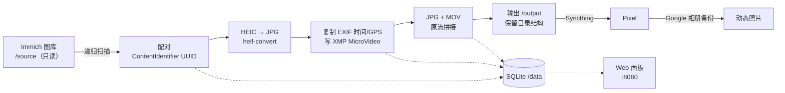

# immich2motion

把 Immich 图库里的苹果 **Live Photo**（HEIC + MOV）转换成 **Google 相册可识别的 Motion Photo**（JPG 容器 + 尾部拼接视频 + XMP `MicroVideo` 元数据），输出目录交给 Syncthing 同步到 Pixel，由 Pixel 的 Google 相册 App 自动备份为「动态照片」。

单 Go 二进制 + 内嵌 Web 面板 + SQLite，一个容器装完 `heif-convert` 与 `exiftool`。



---

## 核心特性

| 能力 | 说明 |
| --- | --- |
| **UUID 配对** | 只认 `ContentIdentifier`，文件名、目录名、修改时间都不参与配对 |
| **增量扫描** | mtime 未变的文件不重复解析元数据、不重复算 MD5；已成功的任务不重复转换 |
| **MD5 完整性校验** | 源文件与产物都记 MD5；支持周期性「深度校验」发现 `mtime 未变但内容变了` 的静默损坏（bit rot） |
| **并发控制** | 可配置并发数（默认 2），任务队列持久化在 SQLite，改并发数**立即生效**无需重启 |
| **容错** | 失败指数退避重试（默认 3 次），崩溃后 `running` 任务自动打回队列，全程事务化 |
| **源目录只读** | 代码层面只以只读方式打开源文件，输出路径做双重越界校验，拒绝写入源目录 |
| **完整图库模式** | 可选：输出目录 = 转换产物 + 已定型文件的原样副本，目录结构与源目录一致。转换成功的双文件只出 JPG；新到/刚失败的源文件先过观察期才写，避免同一张实况在 Pixel 上出现两份 |
| **Web 面板** | 仪表盘 / 任务列表 / 实时日志 / 设置，htmx 局部刷新 + SSE 实时推送，构建期打进二进制 |
| **界面** | 玻璃拟态 + 极光背景，按浏览器本地时间（06:00–18:00）自动切换日夜配色，`?theme=light/dark` 可覆盖 |
| **Webhook** | 以「一轮扫描 → 队列排空」为单位推送：开始一条、结束一条汇总（含失败明细），不逐张刷屏；自动适配钉钉/飞书/企微/Slack/Discord/ntfy/Bark |
| **CLI** | `--web`、`--scan-once`、`--dry-run`，适合 cron 定时跑 |

---

## 快速开始

> 镜像已发布：`docker pull andreasgyh/immich2motion:latest`
>
> 只想跑起来用上面的 pull 即可，不需要 clone 仓库、也不需要本地构建。

### 1. docker compose（推荐）

```bash
git clone https://github.com/immich2motion/immich2motion.git
cd immich2motion
```

编辑 `docker-compose.yml` 里的三条挂载路径：

```yaml
volumes:
  - /volume1/photo/immich/upload:/source:ro   # 源图库，必须 :ro
  - /volume1/photo/motion:/output             # 输出目录，Syncthing 同步这里
  - immich2motion_data:/data                  # SQLite 持久化（具名卷，见下方说明）
```

```bash
docker compose up -d      # 直接拉取镜像，不会本地构建
docker compose logs -f
```

打开 `http://<NAS-IP>:8080`。

> **`/data` 为什么用具名卷**
>
> SQLite 处于 WAL 模式，依赖 `mmap` 与文件锁。Windows/macOS 上 Docker Desktop 的
> bind mount（9p/drvfs）对这两者支持不完整，实测表现为「容器内已提交、宿主机读到旧快照」，
> 容器被强杀时还可能丢数据。
>
> Linux/NAS 上 bind mount 完全没问题，改成 `./data:/data` 即可。

### 2. 直接 docker run

```bash
docker run -d --name immich2motion \
  --restart unless-stopped \
  -p 8080:8080 \
  -v /volume1/photo/immich/upload:/source:ro \
  -v /volume1/photo/motion:/output \
  -v immich2motion_data:/data \
  -e TZ=Asia/Shanghai \
  -e I2M_WORKERS=2 \
  andreasgyh/immich2motion:latest
```

### 3. 自己构建镜像

改过代码、或想固定某个提交时：

```bash
docker build -t immich2motion:local .
```

国内网络下 Dockerfile 默认已指向 `docker.m.daocloud.io` 与 `goproxy.cn`；
能直连官方源时传 `--build-arg REGISTRY=docker.io/library/ --build-arg GOPROXY=https://proxy.golang.org,direct`。

备份数据库：

```bash
docker run --rm -v immich2motion_data:/data -v "$PWD:/backup" alpine \
  tar czf /backup/immich2motion-data.tar.gz -C /data .
```

### 4. 第一次使用建议

1. 打开 **仪表盘 → Dry-Run**，只做扫描与配对，确认「配对组数」符合预期；
2. 打开 **任务列表**，检查 UUID、HEIC 路径、视频路径是否成对；
3. 确认无误后关闭 Dry-Run，任务立即开始转换；
4. 定期看 **日志** 页的 `warn` / `error`。

---

## 配置

优先级：**Web 设置页（存 SQLite）> 环境变量 > 内置默认值**。
环境变量只在首次建库时作为初始值写入，之后以 Web 为准。

| 环境变量 | 默认值 | 说明 |
| --- | --- | --- |
| `I2M_SOURCE_DIR` | `/source` | 源图库目录（只读挂载） |
| `I2M_OUTPUT_DIR` | `/output` | 输出目录 |
| `I2M_DATA_DIR` | `/data` | 数据目录（SQLite） |
| `I2M_WEB_ADDR` | `:8080` | Web 监听地址 |
| `I2M_LOG_LEVEL` | `info` | `info` / `warn` / `error` |
| `I2M_WORKERS` | `2` | 并发转换数（1-16） |
| `I2M_JPG_QUALITY` | `100` | 传给 `heif-convert -q` 的质量 |
| `I2M_ENABLE_MD5` | `true` | MD5 完整性校验总开关 |
| `I2M_AUTO_SCAN` | `true` | 是否后台持续扫描 |
| `I2M_SCAN_INTERVAL_SEC` | `300` | 扫描间隔（秒，最小 10） |
| `I2M_MAX_RETRIES` | `3` | 失败重试次数 |
| `I2M_OUTPUT_SUFFIX` | `-motion` | 输出文件名后缀 |
| `I2M_INCLUDE_UNCONVERTED` | `false` | 完整图库模式：把未参与转换的源文件原样复制到输出目录（见下文） |
| `I2M_MIRROR_SETTLE_MIN` | `30` | 镜像观察期（分钟）：新到/刚失败的源文件先不写进输出目录，等定型；`0` = 立即写 |
| `I2M_AUTO_THEME` | `true` | 面板是否按本地时间自动切换日间/夜间配色 |
| `I2M_EXIFTOOL` | `exiftool` | exiftool 可执行文件路径 |
| `I2M_HEIF_CONVERT` | `heif-convert` | heif-convert 可执行文件路径 |

Web 设置页还可以改：输出文件名后缀、HEIC/视频扩展名、深度校验周期、日志保留条数、是否转换前校验源 MD5、是否保留原始 Orientation、是否开启完整图库模式、镜像观察期。

---

## 目录行为与环境自检

三个挂载路径的处理策略不同，这是刻意的：

| 路径 | 不存在时 | 原因 |
| --- | --- | --- |
| `/source` 源目录 | **不创建，直接报错** | 自动建个空目录只会把「挂载漏了」表现成「扫描成功但 0 个文件」，比报错难排查得多 |
| `/output` 输出目录 | **自动创建** | 程序自己的产出位置，建目录是合理默认行为 |
| `/data` 数据目录 | **自动创建** | SQLite 必须能落盘 |

启动时会自动执行一次环境自检，结果直接显示在仪表盘顶部：

- **阻断项** —— `exiftool`、`heif-convert`、输出目录可写、数据目录可写。
  任一项不通过 → 横幅显示 **「转换已暂停」**，worker 停止领取任务，**队列原样保留**（不会把任务逐条重试成 `failed`）。
- **非阻断项** —— 源目录是否存在 / 可读。
  只有这一项失败时横幅显示 **「仅影响扫描」**，转换能力不受影响。

修好挂载或装好工具后，点横幅右上角的 **「重新检测」**（或全局操作区的「重新检测环境」）即可恢复，**不需要手工重跑失败任务**。

保存设置时的校验：

- 源目录**发生变化**时才强制要求它已存在（只改并发数、质量不会被路径问题卡住）；
- 输出目录自动创建；
- 输出目录落在源目录内部、或二者互相包含，会被拒绝并提示。

---

## 输出格式

输出是一个**单文件**：

```
[ JPG 数据 ][ MOV 数据 ]
|<-- N 字节 -->|
```

- XMP 写入：
  - `GCamera:MicroVideo = 1`
  - `GCamera:MicroVideoVersion = 1`
  - `GCamera:MicroVideoOffset = N`（N = JPG 字节长度）
- `mov` **原样拼接，不转码**，字节数与源文件完全一致。

### 为什么 `MicroVideoOffset` 要迭代写入

`exiftool` 改写 XMP 会改变 JPG 文件长度，而 `MicroVideoOffset` 必须**恰好等于**最终 JPG 长度——两者互相依赖。实现上做迭代收敛：

```
写 offset=0 → 量实际长度 L1
写 offset=L1 → 量实际长度 L2
若 L2 == L1 收敛；否则继续，最多 6 次
```

拼接前还会**回读校验** `MicroVideo=1` 且 `MicroVideoOffset == 文件长度`，不通过直接判失败，绝不产出坏图。

> 没有采用新版的 `GContainer:Directory`（`Item:Length` / `Semantic=Motion`）写法：
> 它要求同时写容器目录，字段更多、兼容性差异更大，而你要求的 `MicroVideo*` 是 Pixel 一代起就在用的格式，Google 相册识别稳定。

---

## 输出内容：两种模式

`/output` 里到底放什么，由 **完整图库模式**（`I2M_INCLUDE_UNCONVERTED`，或设置页「输出内容」）决定。

| | 关闭（默认） | 开启 |
| --- | --- | --- |
| 转换成功的 Live Photo | `IMG_0001-motion.jpg` | `IMG_0001-motion.jpg`，原始 HEIC/MOV **不**复制 |
| 普通照片 / 未配对视频 / 其它文件 | 不输出 | 原样复制，相对路径与源目录一致 |
| 适用场景 | 只想把实况补到别处 | 想用 `/output` 完全替代 `/source` 做同步 |

### 为什么需要这个开关

Live Photo 在磁盘上是两个文件（HEIC + MOV），转换后是一个 JPG。如果同时把 `/source`
（原始 HEIC + MOV）和 `/output`（转换后的 JPG）都同步给 Pixel，同一张实况就会以
「静态照片 + 视频 + 实况照片」几种形态重复出现。

开启后输出目录的形态是：

```
/output/2024/05/IMG_0001-motion.jpg   ← 由 IMG_0001.HEIC + IMG_0001.MOV 合成，原件留在 /source
/output/2024/05/IMG_0002.HEIC         ← 普通照片（没有 ContentIdentifier），原样复制
/output/2024/06/VID_0001.MOV          ← 找不到 HEIC 的孤儿视频，原样复制
/output/2024/06/IMG_0003.HEIC         ← 转换失败的实况原图，原样复制（至少不丢照片）
```

路径结构与源目录**完全一致**（同样是 `年/月/文件名`），不会全部混在输出根目录里。

### 哪些文件会被复制

判据只有一条：**它现在就能确定不会被合成成 Motion Photo 吗**。

输出目录采用「白名单 + 只写终态」：写出去的文件如果之后还要删，对 Syncthing / Immich
这种「看到就上传」的下游来说等于白删——它们早已收下那一份。所以宁可晚一点写，也不写完再撤。

| 源文件状态 | 处理 |
| --- | --- |
| 已转换成功 | 不写；历史遗留副本会被撤回 |
| 等待 / 正在转换 | 不写 |
| 转换失败、但还没过观察期 | 不写（很可能马上重试，重试成功又得删） |
| 转换失败、且已过观察期 | 原样复制（这组短期内不会出 Motion Photo，不复制图库就不完整） |
| 从未配对、已过观察期 | 原样复制 |
| 刚出现的 HEIC/MOV（未过观察期） | 不写（可能只是实况的一半） |
| 非转换类扩展名（JPG / PNG / DNG / AAE …） | 立即复制，永不删除 |
| 隐藏文件、`~syncthing~*.tmp`、`*.tmp` / `*.part` 等临时文件 | 跳过 |
| 源目录里已删除 / 改名的文件 | 对应副本一并删除 |

### 观察期（为什么不是「一到就复制」）

Immich / Syncthing 经常把实况的 HEIC 和 MOV 分两次送到：HEIC 先落地，MOV 几分钟后才到。
如果 HEIC 一到就复制进 `/output`，同步端立刻把它当普通照片传走；等 MOV 到达、转换完成，
输出目录里那份 HEIC 虽然被删了，上游那一份却还在——删除撤不回已经上传的内容，
Pixel 上于是同时出现「静态照片」和「实况照片」。

所以新出现的 HEIC/MOV（以及刚失败的配对）会先按住 `镜像观察期`（`I2M_MIRROR_SETTLE_MIN`，
默认 **30 分钟**，可在设置页改，`0` = 不等待）。观察期内它们不出现在 `/output`，
等定型后再一次性决定写原件还是等转换。仪表盘的「观察中 N 个」就是这个队列。

复制同样是「同目录临时文件 → 原子 rename」，并保留源文件 mtime，Syncthing 看不到半成品。
增量策略与扫描器一致（mtime + 大小），未变化的文件不重复读盘。

触发时机：每次扫描结束后、开启开关时、转换成功时（撤回该组原件副本），
以及 `--scan-once` 队列跑完后各一次。

> 清理只认 `mirror_outputs` 表里的记录——程序绝不会删自己没复制过的文件，
> 你手工放进 `/output` 的东西是安全的。

> 关闭这个开关**不会**删除已经复制出去的文件：那些文件已经和转换产物混在一起，
> 交给用户自己判断更稳妥。

---

## CLI

```bash
# 默认：启动 Web 服务（容器入口）
immich2motion --web

# 扫描一次 + 处理完队列后退出（适合 cron）
immich2motion --scan-once

# 只扫描配对，不转换，打印统计后退出
immich2motion --dry-run

# 打印版本
immich2motion --version
```

容器内执行：

```bash
docker exec -it immich2motion immich2motion --scan-once
```

---

## Web 面板

| 页面 | 内容 |
| --- | --- |
| **仪表盘** `/` | 待处理/处理中/成功/失败统计、当前转换任务与进度条、速度与剩余时间、全局操作按钮、运行信息；扫描期间显示旋转图标 + 当前阶段 + 实时递增的文件计数，不会出现「全是 0」的空转观感 |
| **任务列表** `/jobs` | UUID、HEIC/视频路径与大小、状态、进度、错误信息、单条重转；支持状态筛选、路径/UUID 搜索、分页 |
| **日志** `/logs` | SSE 实时滚动日志，按 info/warn/error 过滤，自动滚动可关闭，可清空 |
| **设置** `/settings` | 目录、并发、质量、后缀、扫描间隔、重试、MD5 相关开关、扩展名、日志保留、外观、通知 |

全局操作：**立即扫描 / 暂停 / 恢复 / Dry-Run / 清空失败标记 / 重跑失败项 / 深度 MD5 校验 / 重新检测环境**。

界面按本地时间自动切换配色：06:00–18:00 日间（浅色玻璃），其余夜间（深色玻璃）。
设置页「外观」里可以关掉自动切换；侧边栏底部的按钮可随时手动切换一次，
自动模式下手动选择只在本时段内有效，跨过 06:00 / 18:00 会交还给自动逻辑。
想在固定主题下调试，URL 加 `?theme=light` 或 `?theme=dark` 即可。
侧边栏底部还有 GitHub 仓库入口。

---

## 通知（Webhook）

在「设置 → 通知（Webhook）」里配置，支持四类事件独立开关：

| 事件 | 触发时机 | 默认 |
| --- | --- | --- |
| 开始处理 | 每轮扫描开始时一条；定时扫描只在发现新照片时推 | 开 |
| 处理完成 | **一整轮「扫描 → 队列排空」结束后**推一条汇总 | 开 |
| 处理失败 | 失败信息并入同一条汇总（数量 + 明细） | 开 |
| 系统故障 | 环境自检失败、扫描失败，立即推送 | 开 |

**推送以「轮」为单位，不再逐张推。** 一轮的定义是：一次扫描开始 → 该轮产生的任务全部处理完
（队列连续 10 秒空闲）。定时扫描什么都没发现时**一条都不发**，因此没有「合并窗口」这个概念了，
设置页也不需要再配窗口时长。

汇总示例：

```
[immich2motion] 本次处理完成（1 个失败）
扫描 1,284 个文件（HEIC 642 / 视频 642），新增配对 12 组
转换成功 11，失败 1
原样复制未转换文件 3 个
耗时 2 分 18 秒

失败明细：
· 2024/05/IMG_5012.HEIC：heif-convert 退出码 1
```

长图库的转换可能比扫描间隔更久，这时连续的几次扫描会**并进同一轮**，
不会被切成若干条「0 成功」的碎片消息。

**格式自动适配**（按域名判断，不需要选平台）：

| 目标 | 报文 |
| --- | --- |
| 钉钉 `oapi.dingtalk.com` | `{"msgtype":"text","text":{"content":…}}` |
| 飞书 `open.feishu.cn` | `{"msg_type":"text","content":{"text":…}}` |
| 企业微信 `qyapi.weixin.qq.com` | 同钉钉 |
| Slack / Discord | `{"text":…}` / `{"content":…}` |
| ntfy | JSON 发布（中文标题不会被 header 限制破坏） |
| Bark `api.day.app` | `{"title":…,"body":…}` |
| 其他地址 | 通用 JSON（见下） |

通用 JSON 便于自建接收端做结构化处理：

```json
{
  "source": "immich2motion",
  "event": "task.success",
  "title": "[immich2motion] 本次处理完成",
  "message": "扫描 1284 个文件（HEIC 642 / 视频 642），新增配对 12 组\n转换成功 12，失败 0\n耗时 2 分 18 秒",
  "at": "2026-11-18T10:36:50+08:00",
  "platform": "generic"
}
```

设置页有「发送测试消息」按钮（用已保存的配置立即发一条）。
推送失败只记日志并重试一次，**不会阻塞转换**。

---

## 数据库

SQLite（`modernc.org/sqlite`，纯 Go 无 CGO），WAL 模式，位于 `/data/immich2motion.db`。

```sql
-- 源文件清单：HEIC 与视频各一行
CREATE TABLE live_assets (
    id              INTEGER PRIMARY KEY AUTOINCREMENT,
    source_root     TEXT    NOT NULL,              -- 源根目录，换库不互相污染
    rel_path        TEXT    NOT NULL,              -- 相对路径
    kind            TEXT    NOT NULL CHECK (kind IN ('heic','video')),
    size_bytes      INTEGER NOT NULL DEFAULT 0,
    mtime_unix      INTEGER NOT NULL DEFAULT 0,
    content_id      TEXT,                          -- ContentIdentifier（配对唯一依据）
    cid_source      TEXT,                          -- 命中的 exiftool 标签组
    md5             TEXT,
    md5_mtime_unix  INTEGER,                       -- 计算 MD5 时的 mtime，用于增量复用
    md5_checked_at  INTEGER,
    state           TEXT    NOT NULL DEFAULT 'ok', -- ok|no_cid|unreadable|bitrot|missing
    warning         TEXT,
    first_seen_at   INTEGER NOT NULL,
    last_seen_at    INTEGER NOT NULL,
    last_scan_id    INTEGER NOT NULL DEFAULT 0,
    updated_at      INTEGER NOT NULL
);
CREATE UNIQUE INDEX ux_assets_root_path ON live_assets(source_root, rel_path);
CREATE INDEX ix_assets_cid ON live_assets(source_root, content_id);

-- 配对结果：一行 = 一组已确认的 Live Photo
CREATE TABLE live_pairs (
    id             INTEGER PRIMARY KEY AUTOINCREMENT,
    source_root    TEXT    NOT NULL,
    content_id     TEXT    NOT NULL,
    heic_asset_id  INTEGER NOT NULL REFERENCES live_assets(id) ON DELETE CASCADE,
    video_asset_id INTEGER NOT NULL REFERENCES live_assets(id) ON DELETE CASCADE,
    heic_rel_path  TEXT    NOT NULL,
    video_rel_path TEXT    NOT NULL,
    heic_mtime     INTEGER NOT NULL DEFAULT 0,     -- 源指纹快照，用于发现变化后重转
    video_mtime    INTEGER NOT NULL DEFAULT 0,
    heic_size      INTEGER NOT NULL DEFAULT 0,
    video_size     INTEGER NOT NULL DEFAULT 0,
    created_at     INTEGER NOT NULL,
    updated_at     INTEGER NOT NULL,
    UNIQUE (source_root, heic_asset_id, video_asset_id)
);

-- 转换任务：与配对一对一
CREATE TABLE jobs (
    id            INTEGER PRIMARY KEY AUTOINCREMENT,
    pair_id       INTEGER NOT NULL UNIQUE REFERENCES live_pairs(id) ON DELETE CASCADE,
    status        TEXT    NOT NULL DEFAULT 'pending',  -- pending|running|success|failed|skipped
    stage         TEXT,
    progress      REAL    NOT NULL DEFAULT 0,
    attempts      INTEGER NOT NULL DEFAULT 0,
    max_attempts  INTEGER NOT NULL DEFAULT 3,
    last_error    TEXT,
    next_retry_at INTEGER,                             -- 指数退避
    started_at    INTEGER,
    finished_at   INTEGER,
    created_at    INTEGER NOT NULL,
    updated_at    INTEGER NOT NULL
);
CREATE INDEX ix_jobs_status ON jobs(status);

-- 输出产物
CREATE TABLE motion_outputs (
    id           INTEGER PRIMARY KEY AUTOINCREMENT,
    pair_id      INTEGER NOT NULL REFERENCES live_pairs(id) ON DELETE CASCADE,
    job_id       INTEGER,
    source_root  TEXT    NOT NULL,
    rel_path     TEXT    NOT NULL,
    abs_path     TEXT    NOT NULL,
    size_bytes   INTEGER NOT NULL,
    jpg_bytes    INTEGER NOT NULL,     -- 等于 MicroVideoOffset
    video_bytes  INTEGER NOT NULL,
    md5          TEXT,                 -- 产物完整性校验
    xmp_verified INTEGER NOT NULL DEFAULT 0,
    created_at   INTEGER NOT NULL,
    verified_at  INTEGER,
    UNIQUE (source_root, rel_path)
);

-- 未转换文件的镜像副本（完整图库模式）
CREATE TABLE mirror_outputs (
    id          INTEGER PRIMARY KEY AUTOINCREMENT,
    source_root TEXT    NOT NULL,
    rel_path    TEXT    NOT NULL,      -- 与源目录一致的相对路径
    size_bytes  INTEGER NOT NULL DEFAULT 0,
    mtime_unix  INTEGER NOT NULL DEFAULT 0,
    copied_at   INTEGER NOT NULL,
    updated_at  INTEGER NOT NULL,
    UNIQUE (source_root, rel_path)     -- 清理时只删有记录的文件
);

-- 运行日志 / 扫描批次 / 键值设置 / bit rot 事件
CREATE TABLE logs             (id INTEGER PRIMARY KEY AUTOINCREMENT, ts INTEGER NOT NULL,
                               level TEXT NOT NULL, scope TEXT, message TEXT NOT NULL);
CREATE TABLE scans            (id INTEGER PRIMARY KEY AUTOINCREMENT, source_root TEXT NOT NULL,
                               trigger TEXT NOT NULL, started_at INTEGER NOT NULL, finished_at INTEGER,
                               files_seen INTEGER DEFAULT 0, heic_seen INTEGER DEFAULT 0,
                               video_seen INTEGER DEFAULT 0, pairs_total INTEGER DEFAULT 0,
                               pairs_new INTEGER DEFAULT 0, pairs_unpaired INTEGER DEFAULT 0,
                               warnings INTEGER DEFAULT 0, error TEXT);
CREATE TABLE settings         (key TEXT PRIMARY KEY, value TEXT NOT NULL, updated_at INTEGER NOT NULL);
CREATE TABLE integrity_events (id INTEGER PRIMARY KEY AUTOINCREMENT, asset_id INTEGER NOT NULL,
                               rel_path TEXT NOT NULL, kind TEXT NOT NULL, old_md5 TEXT, new_md5 TEXT,
                               detail TEXT, created_at INTEGER NOT NULL);
CREATE TABLE schema_meta      (key TEXT PRIMARY KEY, value TEXT NOT NULL);
```

---

## 项目结构

```
immich2motion/
├── cmd/immich2motion/main.go        # 入口：flag 解析、Web/CLI 模式分派、优雅退出
├── internal/
│   ├── config/                      # 启动期配置（env）+ 运行期设置（可持久化、可校验）
│   │   ├── config.go
│   │   └── settings.go
│   ├── store/                       # SQLite 持久化层
│   │   ├── db.go                    # 连接、PRAGMA、迁移、事务重试
│   │   ├── schema.go                # 全部建表 DDL
│   │   ├── assets.go / bulk.go      # 源资产 CRUD + 批量写（扫描性能关键）
│   │   ├── pairs.go                 # 配对登记
│   │   ├── jobs.go                  # 任务队列：原子领取、退避重试、崩溃恢复
│   │   ├── outputs.go               # 产物记录
│   │   ├── logs.go / scans.go       # 日志、扫描批次、完整性事件
│   │   └── settings.go              # 设置读写（JSON blob）
│   ├── library/                     # 图库感知层
│   │   ├── scanner.go               # 递归扫描 + 增量 + MD5 复用 + 配对入库
│   │   ├── exiftool.go              # 批量读取 ContentIdentifier（含标签组优先级）
│   │   ├── pair.go                  # 纯函数配对算法（同目录优先 + 一对一贪心）
│   │   └── hash.go                  # MD5
│   ├── convert/                     # 转换流水线
│   │   ├── pipeline.go              # HEIC→JPG、XMP 迭代写入、拼接、校验、原子落盘
│   │   └── tools.go                 # 外部命令执行与错误封装
│   ├── mirror/                      # 完整图库模式
│   │   └── mirror.go                # 未转换文件原样复制 + 遗留副本清理（只删自己复制过的文件）
│   ├── engine/                      # 调度
│   │   ├── engine.go                # 扫描循环、worker 池、状态机、统计
│   │   ├── sem.go                   # 可动态调整上限的信号量（并发数热生效）
│   │   └── events.go                # 事件总线 + 吞吐/ETA 估算
│   └── web/                         # 内嵌 Web 面板
│       ├── server.go                # 路由、模板装载、格式化函数
│       ├── handlers.go              # 页面与操作接口
│       ├── sse.go                   # SSE 实时推送
│       ├── templates/               # html/template（4 页面 + 局部片段）
│       └── assets/                  # go:embed：app.css / app.js / htmx.min.js
├── web/input.css                    # Tailwind 源文件
├── tailwind.config.js
├── Dockerfile                       # 多阶段构建
├── docker-compose.yml
└── .dockerignore
```

---

## 自动构建（GitHub Actions）

`.github/workflows/release.yml` 已配好：推送到 `main` 自动构建并推送到 Docker Hub（linux/amd64）。

需要在仓库 **Settings → Secrets and variables → Actions** 里加两个 secret：

| Secret | 说明 |
| --- | --- |
| `DOCKER_USERNAME` | Docker Hub 用户名 |
| `DOCKERHUB_TOKEN` | Docker Hub **Access Token**（不是登录密码） |

镜像名写在 `docker/metadata-action` 的 `images:` 一行，当前是 `${{ secrets.DOCKER_USERNAME }}/immich2motion`，
即发布到 **`andreasgyh/immich2motion`**。换仓库只改这一行。

标签规则：

| 触发 | 产出的标签 |
| --- | --- |
| 推送 `main` | `latest`、`sha-1a2b3c4` |
| 推送 `v1.2.3` 标签 | `1.2.3`、`1.2`、`1`、`sha-…` |
| 手动 Run workflow | 同上（按当前 ref 判定） |

CI 里显式传了 `REGISTRY=docker.io/library/` 和 `GOPROXY=https://proxy.golang.org,direct`，
所以构建直接走官方源、不绕国内加速；本地构建仍默认用 `docker.m.daocloud.io`。

---

## 开发

```bash
# 依赖（纯 Go，无 CGO）
go mod download

# 构建（前端资源已提交到仓库，无需 node 也能构建）
CGO_ENABLED=0 go build -o immich2motion ./cmd/immich2motion

# 改样式后重新编译 Tailwind
npx tailwindcss@3.4.17 -c tailwind.config.js -i web/input.css -o internal/web/assets/app.css --minify

# 单元测试（配对算法、标签解析等，无需外部工具）
go test ./...

# 集成测试：需要真实 exiftool + 一个 heif 解码器
I2M_TEST_EXIF_BIN=/usr/bin/exiftool \
I2M_TEST_HEIF_BIN=/usr/bin/heif-convert \
go test -tags integration ./... -v
```

集成测试覆盖：JPG+MOV 拼接字节级一致性、`MicroVideoOffset` 收敛、EXIF/GPS 保留、MD5、
源文件零改动、临时文件清理、扫描→配对→入队→转换→落盘的完整链路、重复扫描幂等。

---

## 设计取舍与已知限制

- **运行镜像基于 Debian trixie，不是 bookworm**。bookworm 自带 libheif 1.15.1 / exiftool 12.57（2022 年），
  实测在 iPhone 16 Pro Max 的照片上有两个硬伤：
  exiftool 读不出 HEIC 里 MakerNotes 的 `ContentIdentifier`（配对恒为 0）；
  libheif 解不了带多个辅助图（HDR gain map / sky matte / style delta map）的 HEIC，
  报 `Too many auxiliary image references`。trixie 的 libheif 1.23 + exiftool 13.25 均正常。
  这两个问题只在真实新机型照片上暴露，小图测试不会发现——如果你的图库全是老机型，
  bookworm 也能跑，但不建议。
- 附带的兼容处理：exiftool 13.x 会把大整数（如 `MicroVideoOffset`）的 JSON 输出成科学计数法，
  校验逻辑同时接受整数与浮点两种写法。
- **只输出 JPG**：HEIC 作为 Motion Photo 容器在 Google 相册侧不可靠，固定输出 `.jpg`。
- **视频不转码**：直接原流拼接，速度取决于磁盘 IO。若 Immich 里存的是 `.mp4`，按扩展名配置扫描即可（默认已包含）。
- **Orientation**：`heif-convert` 会把 `irot` 旋转变换直接作用到像素上，因此默认**不复制**原始 `EXIF:Orientation`，避免看图软件二次旋转。若你的 `heif-convert` 版本不应用旋转，可在设置页打开「保留原始 EXIF Orientation」。
- **配对不做模糊匹配**：UUID 不一致就是配不上，宁可报「未配对」也不猜。孤儿文件（有 HEIC 无视频 / 有视频无 HEIC）只统计不生成任务。
- **普通照片不入库任务**：没有 `ContentIdentifier` 的 HEIC 标记为 `no_cid`，不参与配对、不计孤儿，扫描时日志采样输出。
- **不读 Immich 数据库**：纯磁盘扫描。`internal/library/scanner.go` 的 `ScanOptions` 是扩展点，后续可加 Immich API 实现增量拉取。
- **权限**：容器默认以 root 运行以便写入宿主挂载目录。需要降权时在 compose 里加 `user: "1000:1000"`，并确保 `/output`、`/data` 对该 UID 可写。
- **healthcheck**：不依赖镜像里的 curl/wget，用二进制自身的 `--health-check` 子命令探测 `/healthz`。
- **源目录不自动创建**：见上文「目录行为」——宁可报错，也不要用一个空目录掩盖挂载错误。
- **完整图库模式是"最终态同步"，不是双向同步**：它只负责把源目录里该出现的文件复制过去、把
  不再需要的副本删掉。你在 `/output` 里额外放的东西不会被清理，关掉开关也不会回收已复制的文件。
  首次开启会一次性复制整个图库（除已转换的实况原件），大图库上这一步会跑得比较久，
  期间转换仍照常进行。

### Syncthing 侧建议

在同步文件夹的 `.stignore` 里加：

```
(?i)*.tmp
(?).i2m-*
```

程序的临时文件是同目录的 `.i2m-*.jpg` / `.i2m-*.tmp`，转换完成后才原子 `rename` 成最终文件，正常情况下 Syncthing 不会看到半成品，加上忽略规则更保险。

Pixel 端建议让 Google 相册只**备份**该目录（选择「设备文件夹」），并保留原图；上传后 Google 相册会把 `MicroVideo` 识别为动态照片。

---

## License

MIT
